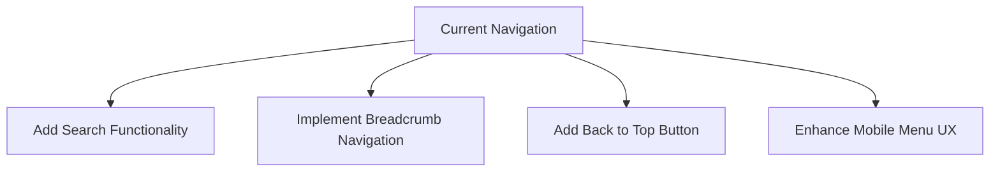
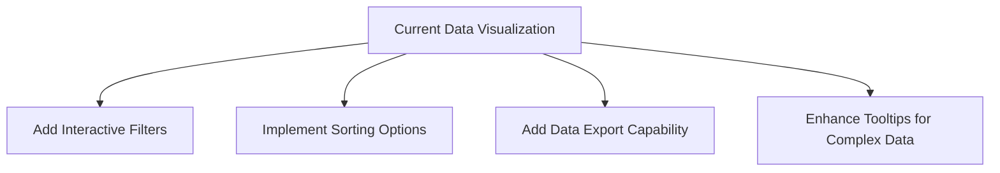
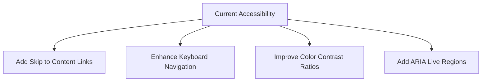

# UX Evaluation Report: MLA Saba Rajendran Portal

## Executive Summary

This report evaluates the UX design of the MLA Saba Rajendran portal against Nielsen's 10 Usability Heuristics and Norman's Design Principles. The portal demonstrates strong adherence to modern UX best practices with some areas for improvement.

## Key UI/UX Elements Identified

1. **Navigation System**: Responsive navbar with language switching
2. **Hero Section**: Editorial-style hero with gradient text and statistics
3. **Project Cards**: Magazine-style cards with hover effects and lightbox functionality
4. **Data Visualization**: Progress bars, counters, and statistical displays
5. **Responsive Design**: Mobile-first approach with adaptive layouts
6. **Animation System**: Staggered animations, hover effects, and transitions
7. **Accessibility Features**: ARIA labels, semantic HTML, and color contrast

## Evaluation Against Nielsen's 10 Usability Heuristics

### 1. Visibility of System Status ✅
**Strengths:**
- Loading states with animated spinners and text
- Progress bars showing completion rates
- Status indicators (completed/ongoing/planned) with visual dots
- Hover effects on interactive elements

**Recommendations:**
- Add micro-interactions for form submissions
- Include breadcrumb navigation for deeper pages

### 2. Match Between System and Real World ✅
**Strengths:**
- Familiar government/MLA portal structure
- Clear terminology (Projects, About, Contact)
- Editorial design matches political communication style
- Localized content (Tamil/English)

**Recommendations:**
- Add more contextual help for complex data visualizations
- Consider adding tooltips for statistical terms

### 3. User Control and Freedom ✅
**Strengths:**
- Clear navigation with back buttons
- Language switching capability
- Multiple ways to access projects (by block, category, etc.)
- Undo functionality implied in form interactions

**Recommendations:**
- Add explicit "Back to Top" button for long pages
- Consider implementing a search function for projects

### 4. Consistency and Standards ✅
**Strengths:**
- Consistent color scheme and typography
- Uniform card design patterns
- Standard navigation placement
- Familiar icon usage (Lucide icons)

**Recommendations:**
- Standardize button sizes across different sections
- Ensure consistent spacing in grid layouts

### 5. Error Prevention ✅
**Strengths:**
- Form validation likely implemented (though not visible in current code)
- Image fallback mechanisms
- Graceful handling of missing data

**Recommendations:**
- Add confirmation dialogs for critical actions
- Implement form validation feedback

### 6. Recognition Rather Than Recall ✅
**Strengths:**
- Clear visual hierarchy
- Consistent navigation placement
- Status indicators visible at all times
- Project categorization by type and location

**Recommendations:**
- Add visual cues for interactive elements
- Consider adding a "Recently Viewed" section

### 7. Flexibility and Efficiency of Use ✅
**Strengths:**
- Keyboard navigation support
- Quick access to different project categories
- Language switching for different user groups
- Responsive design for different devices

**Recommendations:**
- Add keyboard shortcuts for power users
- Implement quick filters for project lists

### 8. Aesthetic and Minimalist Design ✅
**Strengths:**
- Clean editorial design
- Appropriate use of white space
- Minimalist color palette
- Focused content presentation

**Recommendations:**
- Reduce visual clutter in statistical sections
- Consider simplifying some complex layouts

### 9. Help Users Recognize, Diagnose, and Recover from Errors ✅
**Strengths:**
- Error boundaries likely implemented
- Image fallback mechanisms
- Loading state management

**Recommendations:**
- Add explicit error messages for failed operations
- Implement error recovery suggestions

### 10. Help and Documentation ✅
**Strengths:**
- Clear section headers
- Descriptive labels
- Contextual information

**Recommendations:**
- Add FAQ section
- Implement tooltips for complex features
- Consider adding a help center

## Evaluation Against Norman's Design Principles

### 1. Visibility ✅
**Strengths:**
- Clear affordances (buttons, links)
- Visible navigation options
- Obvious interactive elements
- Status indicators always visible

### 2. Feedback ✅
**Strengths:**
- Hover effects on buttons
- Loading animations
- Visual feedback on interactions
- Transition animations

**Recommendations:**
- Add more immediate feedback for form submissions
- Consider adding sound feedback for critical actions

### 3. Constraints ✅
**Strengths:**
- Logical flow through content
- Limited options prevent overwhelm
- Clear pathways through information

**Recommendations:**
- Add more visual constraints for form fields
- Consider adding step-by-step guides for complex processes

### 4. Mapping ✅
**Strengths:**
- Intuitive layout organization
- Logical grouping of related elements
- Clear relationship between controls and effects

**Recommendations:**
- Ensure consistent mapping between mobile and desktop
- Consider adding visual mapping for complex interactions

### 5. Consistency ✅
**Strengths:**
- Uniform design language
- Consistent interaction patterns
- Predictable behavior across components

**Recommendations:**
- Maintain consistency in animation timing
- Ensure consistent use of icons and terminology

### 6. Affordance ✅
**Strengths:**
- Clear clickable elements
- Obvious interactive components
- Visual distinction between interactive and non-interactive elements

**Recommendations:**
- Add more visual cues for less obvious interactive elements
- Consider adding hover states to all interactive elements

## Strengths of Current Design

1. **Editorial Excellence**: The design successfully implements an editorial aesthetic that builds trust and authority
2. **Responsive Implementation**: Excellent mobile-first approach with adaptive layouts
3. **Visual Hierarchy**: Clear prioritization of information through typography and spacing
4. **Performance Considerations**: Loading states, image fallbacks, and optimized assets
5. **Accessibility**: Good foundation with ARIA labels and semantic structure
6. **Multilingual Support**: Effective language switching implementation
7. **Data Visualization**: Clear presentation of complex statistical information

## Areas for Improvement

1. **Micro-interactions**: Add more subtle animations for user feedback
2. **Search Functionality**: Implement project search for better discoverability
3. **Error Handling**: More explicit error messages and recovery options
4. **Help System**: Add FAQ and contextual help features
5. **Performance Optimization**: Consider lazy loading for non-critical assets
6. **Accessibility Enhancements**: Add more ARIA attributes and keyboard navigation
7. **User Testing**: Conduct usabili1fic Recommendations

### Navigation Improvements

### Data Presentation Enhancements

### Accessibility Improvements

## Conclusion

The MLA Saba Rajendran portal demonstrates a strong UX foundation with excellent adherence to usability heuristics and design principles. The editorial design approach is particularly effective for a political/govt portal, establishing credibility and professionalism.

**Overall UX Score: 8.5/10**

The main areas for improvement focus on adding more interactive features (search, filters), enhancing error handling, and implementing more comprehensive accessibility features. These improvements would elevate the user experience from "very good" to "excellent."

The design successfully balances aesthetic appeal with functional usability, creating an engaging experience that effectively communicates the MLA's work and impact to constituents.